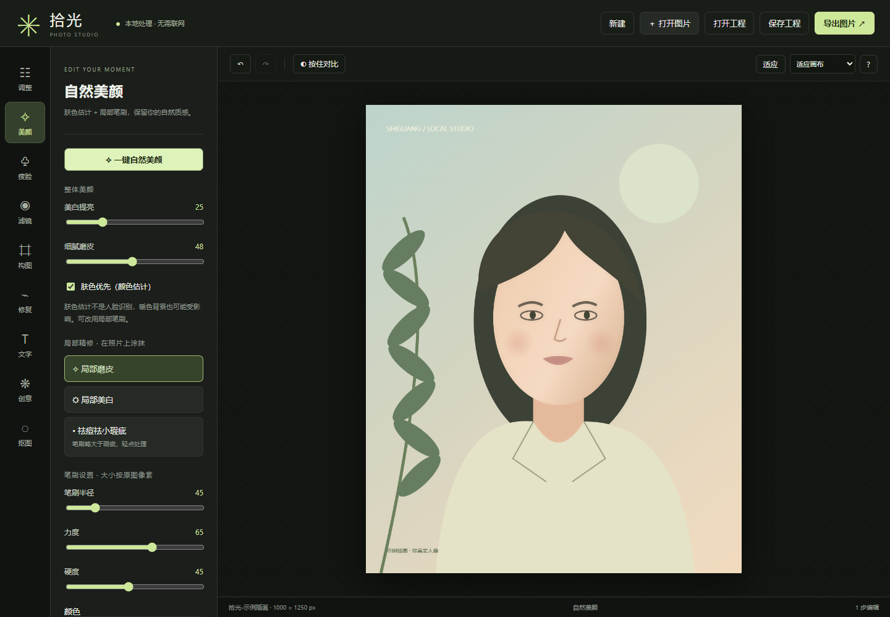

# 拾光 · 本地修图工作室

一个免费、离线、无需安装的中文修图工具。使用 HTML、CSS、JavaScript 和浏览器 Canvas 实现，不需要 Python、虚拟环境、Node、账号或付费接口。

## 怎么打开

1. 如果拿到 ZIP，先**全部解压**到一个文件夹，不能只拖出 HTML 文件。
2. 双击 **启动拾光.cmd**，或用浏览器打开 **index.html**。
3. 点击“打开图片”，也可以拖入照片或粘贴剪贴板中的图片。
4. 选择左侧工具修改，右上角“导出图片”下载结果。

浏览器应当允许 JavaScript、本地文件和下载。本次在 Windows 的 Chrome 上完成自动验证。Edge 可作为兼容浏览器选择，但本次未单独实测。启动脚本使用系统默认浏览器；如果默认打开方式不正确，请右键 index.html → 打开方式 → Chrome 或 Edge。

它是本地浏览器应用，不是打包 EXE；文件夹可以直接复制到其他电脑使用。没有服务器需要启动，断网也能用。

## 包含的功能

| 工具 | 可以做什么 |
| --- | --- |
| 调整 | 分析明暗的一键优化，曝光、亮度、对比度、高光、阴影、饱和度、自然饱和度、色温、色调、清晰度、暗角、褪色 |
| 美颜 | 一键自然美颜，肤色优先美白与磨皮，局部美白、局部磨皮、祛痘笔刷 |
| 瘦脸 | 点击定位后对称收窄，推拉液化，局部放大/大眼，局部缩小 |
| 滤镜 | 原片及清透、暖阳、胶片、冷调、黑白、玫瑰、电影、复古、柔雾、落日、森系，浓度可调 |
| 构图 | 自由/固定比例裁剪，左右 90° 旋转、任意 ±45° 旋转，水平/垂直翻转，像素尺寸修改 |
| 修复 | 祛痘、克隆图章、马赛克、局部模糊、自由画笔、透明橡皮擦、矩形/椭圆/箭头、取色 |
| 文字 | 多行文字、颜色、系统字体、大小、加粗、描边、阴影、旋转、不透明度 |
| 图层 | 文字、表情贴纸、本地图片叠加；拖动、复制、删除、显隐、调整层叠顺序 |
| 创意 | 贴纸、外侧画框、拍立得留白、透明背景填色 |
| 抠图 | 点击选择颜色、容差、边缘过渡、连通区域限制、橡皮擦精修 |
| 文件 | 新建透明/纯色画布、打开图片、打开/保存工程、PNG/JPG/WebP 导出、自定义尺寸与画质 |
| 工作区 | 撤销/重做、缩放、适应窗口、按住对比导入原图、恢复原图（可撤销） |

## 常用操作

### 美白、磨皮、一键优化

先用“调整 → 一键优化”处理整体明暗，再进“美颜”点“一键自然美颜”，根据照片把美白与磨皮强度减弱或增加。“肤色优先”使用像素颜色估计，不是人脸识别；暖色衣服或背景也可能被处理。需要准确限定区域时，使用局部美白/局部磨皮，直接在脸上涂抹。

### 瘦脸和大眼

1. “瘦脸 → 对称瘦脸”，点击脸部中心，通常在鼻子附近。
2. 调整半宽、半高，使椭圆包住面部，使用较低力度，点击“应用对称瘦脸”。
3. 或选“推拉液化”，从脸颊外侧向内短距离拖动。
4. “局部放大 / 大眼”点击眼睛即可。减小半径和力度可以更精细。

这些操作都需要你手动定位，没有自动识别人脸。局部形变可能带动周围背景，多次小幅操作更容易控制。每次松开鼠标可以撤销。

### 祛痘和克隆

祛痘采用周边颜色混合，适合小斑点，不是生成式物体消除。笔刷略大于瑕疵后轻点。如果需要复制实际纹理，选“克隆图章”，按住 Alt 并点击干净区域取样，再涂抹目标。每次笔划按来源与落笔点的偏移取样。

### 抠图和换底色

适合单色背景、产品图和证件照：选“抠图”，点击背景，调容差和边缘过渡后继续点击。默认只删除相连的同色区域，可避免隔空删除其他同色区域。透明部分显示棋盘格。“创意 → 透明背景填色”可以换成纯色底。

复杂头发、透明物体、复杂场景没有智能分割模型支持，可能需要大量手动处理，不等同于专业人像抠图。PNG 和 WebP 可保留透明；JPG 会合成导出面板选择的底色。

### 做拼图、封面或海报

“新建”选择画布尺寸，然后“文字 → 叠加图片”添加多张图片。点击某一图层，再拖动位置、调整大小或旋转，加文字和贴纸，最后导出。图片图层按原比例调整大小；没有独立图层蒙版或混合模式。

### 保存并下次继续

- **导出图片**：下载最终合成的 PNG、JPG 或 WebP。
- **保存工程**：下载 `.sgphoto`，保留当前底图、导入时的原图、调色参数和可编辑的文字/贴纸/图片图层。
- **打开工程**：恢复编辑状态；撤销历史从这次打开重新开始。
- 工程文件最大 256MB，过大时请减少叠加图片或缩小画布。
- 文件保存位置由浏览器决定，通常在“下载”文件夹。请确认文件已下载完成。
- **关闭页面不会自动保存工程。** 未保存编辑会触发浏览器离开提示。

## 快捷键

| 按键 | 操作 |
| --- | --- |
| Ctrl+O | 打开图片 |
| Ctrl+S | 保存工程（输入框中也可使用） |
| Ctrl+E | 导出图片 |
| Ctrl+Z | 撤销（输入框中遵循文字编辑行为） |
| Ctrl+Shift+Z / Ctrl+Y | 重做 |
| 按住空格 | 查看导入时的原图；松开回到编辑结果 |
| Delete / Backspace | 删除选中的叠加图层 |
| Esc | 取消裁剪选区或图层选择 |
| [ / ] | 缩小/放大笔刷 |
| Alt+点击 | 克隆图章取样 |

## 尺寸、内存与处理规则

- 导入默认最大边长 **2400px**；“调整”面板底部可改为 1600 或 4096，**对下一次导入生效**。超限图片等比缩小，原文件不会被覆盖。
- 工程中的“导入原图”是导入缩放后的图像。想保留更大的源照片，请另存原文件。
- 新建、编辑变换和导出单边最高 8192px，总像素最高 2000 万；不是无限制大图编辑器。
- 叠加图片导入时最大边长 1400px，避免拼图占用过多内存；图层最多 100 个，每个文字图层最多 1000 字符。
- 撤销最多保留 20 步，压缩快照按约 96MB 的软上限清理，至少留两份快照。**这不是浏览器进程的总内存上限**。
- 大图拖动整体调色参数时使用最大边长 1100px 的临时预览，松开后渲染完整编辑分辨率。导出使用完整编辑分辨率，不导出低精度预览。
- 局部笔刷、液化、裁剪、翻转、画框等操作前，会将当前调色/美颜合并到底图并归零滑块，保证后续局部编辑与预览一致；可以撤销回到合并前。
- 调色只影响底图；文字与贴纸最后叠加。旋转、裁剪、等比缩放会同步变换叠加图层。**非等比缩放有叠加图层时，会合并图层**，可撤销恢复。
- 导出只生成静态图像，PNG 为无损格式，JPG/WebP 可调画质。放大导出不会增加真实细节；导出不保留 EXIF、GPS 等原文件元数据。
- HEIC、RAW、PSD、多帧 GIF、CMYK/专业色彩管理不在支持范围；GIF 若能打开，只处理浏览器解码的静态帧。建议使用 JPG、PNG、WebP。

## 隐私与费用

没有上传服务、分析统计、远程字体、外部脚本、联网模型或付费 API。照片仅在本页面内处理；工程和导出文件经浏览器下载到你的设备。浏览器本地存储仅记录导入尺寸偏好，不自动保存照片。

## 能力边界

这是可直接使用的常规修图与手动美颜工具，**不声称复刻美图秀秀全部商业能力**。不包含自动人脸关键点、自动妆容、AI 换脸、生成式扩图/消除、智能人像分割、专业曲线/色彩空间、PSD 图层兼容。美颜强度是像素算法参数，并不是效果质量的业务保证。请用自己的照片检查最终审美效果；内置示例是程序插画，不是真实人像。

## 源码与验证

- `index.html`：界面和对话框。
- `style.css`：工作区和响应式布局。
- `engine.js`：像素调色、美白磨皮、笔刷、局部形变、颜色抠图。
- `app.js`：文件导入导出、交互、图层、工程、撤销历史。
- `icon.svg`：应用图标。
- `启动拾光.cmd`：Windows 启动器，只打开同目录的 HTML。
- `RUN_LOG.md`：操作记录、测试结果与未完成能力。

### 开发验证

运行软件本身不需要 Node。只有修改代码和运行测试时，才需要 Node.js、npm 和已安装的 Chrome：

```sh
npm install
npm test
```

测试自动生成合成图片、工程文件和截图，放入已忽略的 `verification/`。先运行主验证，再运行边界与收尾验证；`npm test` 已按此顺序组织。没有上传个人照片或现有工程。

Windows 上可运行 `powershell -NoProfile -File package.ps1` 生成轻量分享 ZIP（需先完成测试）。



## 作品分类

本项目使用 GitHub Topics 标记用途。同系列公开项目：

| 类别 | 项目 |
| --- | --- |
| 图像与创作 | [拾光修图](https://github.com/JiaDongZou/photo-studio) |
| 英语与学习 | [句间英语播放器](https://github.com/JiaDongZou/english-study-player) |
| AI 与电商分析 | [CBEC 推荐与运营分析](https://github.com/JiaDongZou/cbec-recommendation-assistant) |
| 生活与微信小程序 | [我的私人食谱](https://github.com/JiaDongZou/recipe-miniprogram) |
